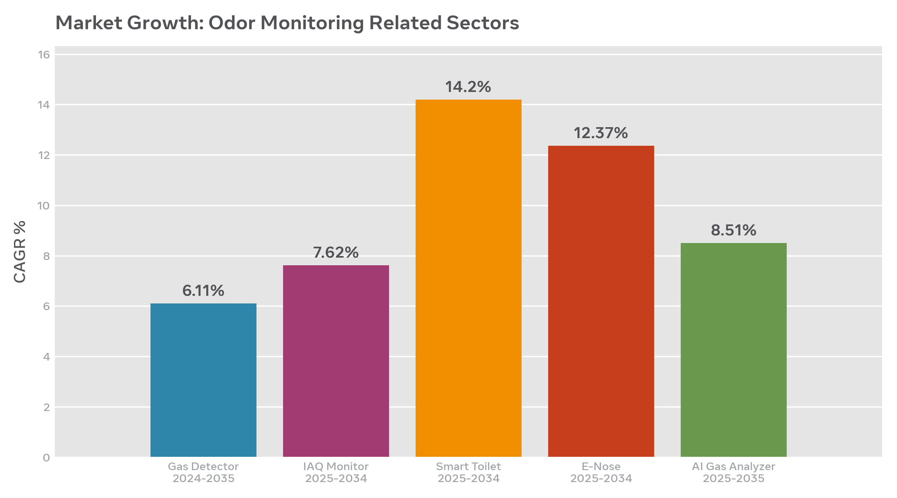
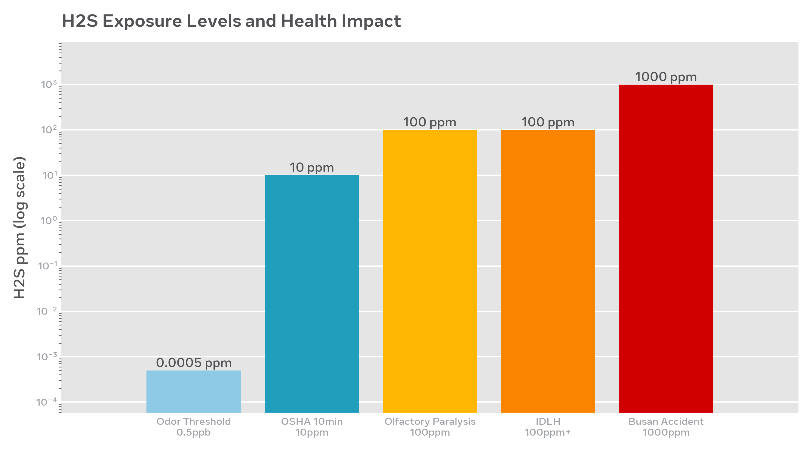
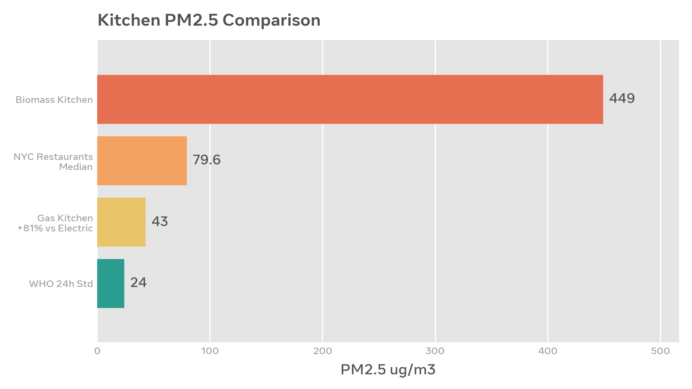
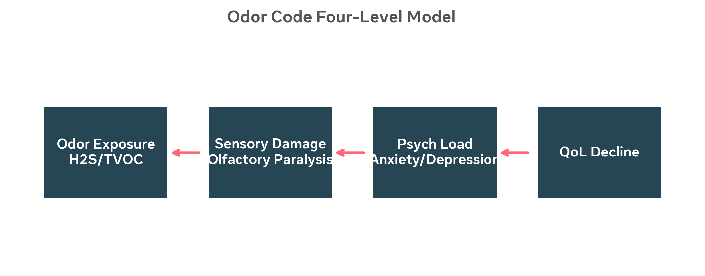

# 气味密码 Odor Code — 未来人类生活质量的重要一环

> **From Olfactory Science to Smart Toilets: How Odor Monitoring Becomes Essential Infrastructure for Quality of Life**

[]()
[]()
[]()
[]()

## 🌟 概述 Overview

人类90%时间在室内，室内污染是室外的2-5倍。东英吉利大学2026年研究揭示嗅觉丧失对生活质量的影响堪比糖尿病、中风。本仓库整合了 **《气味密码》** 综合研究报告、行业市场分析、图文文档与双语语音PPT。

Humans spend 90% indoors. Odor is not comfort — it is a 4-level chain: Exposure → Sensory Damage → Psychological Load → QoL Decline.

### 核心发现 Key Findings
- **H2S**: 100ppm 嗅觉麻痹3-15分钟，釜山事故1000ppm致死
- **Kitchen PM2.5**: 燃气厨房比电磁+81%，纽约餐厅中位数79.6 vs WHO 24
- **Market**: 气体探测 $13.27B→$25.49B, 智慧公厕 $2.72B→$8.54B CAGR 14.2%, E-Nose $157M→$449M CAGR 12.37%
- **Tech**: Renesas ZMOD4410 e-AI区分硫基/乙醇, DGIST激光石墨烯>95%准确率, 神经形态芯片接近人类

## 📁 仓库结构 Structure

```
├── reports/          # Markdown 深度报告
│   ├── odor-code-full-report-cn.md
│   └── odor-monitoring-market-report.md
├── docs/             # 图文并茂正式文档
│   ├── odor-code-report.docx
│   └── odor-code-report.pdf
├── slides/           # 15页双语语音PPT (HTML)
├── charts/           # 8张数据可视化图表
├── assets/           # 生成视觉资产
└── README.md
```

## 📊 图表预览 Charts

| 市场增速 | H2S暴露 | 厨房PM2.5 | 四级模型 |
|---------|---------|----------|---------|
|  |  |  |  |

## 🎤 PPT演示 Features

- **双语切换 CN/EN Toggle**：右上角按钮一键切换
- **语音讲解 Voice Narration**：每页▶按钮调用 Web Speech API (zh-CN/en-US)
- **Seafoam主题**：科技感+健康+嗅觉可视化

本地打开 `slides/cover.html` 开始，或部署到 GitHub Pages。

## 🚀 部署到 GitHub Pages

```bash
# 1. 创建新仓库后
git init
git add .
git commit -m "feat: odor code full release v1.0"

# 2. 推送
git branch -M main
git remote add origin https://github.com/<YOUR_USERNAME>/odor-code.git
git push -u origin main

# 3. 在 GitHub Settings → Pages → Source: main / root
# 访问 https://<YOUR_USERNAME>.github.io/odor-code/slides/cover.html
```

## 🔬 理论贡献 Theory

提出“气味密码”四级模型，经济价值以DALY衡量，气味监测是未来生活质量必备基础设施，不是可选清新剂。

## 📦 AERISENS Pro 实践

- **BOM**: ¥383 (1k units) → **售价**: ¥1299 / $199 → **毛利**: 66%
- **订阅**: ¥8/月纯露 → **LTV 3年**: ¥1587
- **路径**: 2026卡位三合一+长清样板 → 2027-28 DGIST阵列根因诊断 → 2029+第三方标准

## 📚 引用 Sources

Market Research Future, Growth Market Reports, UEA 2026 Clinical Otolaryngology, DGIST ACS Nano 2025, Nature Reviews Electrical Engineering 2025, Jinan Changqing 2026, ETtoday Busan 1000ppm, NYC PM2.5 study.

## 📄 License

MIT — 欢迎引用与二次开发，请保留来源。

---

**Author**: AERISENS Team | Shanghai, 2026.10
